# Neat Change Studio

<p align="center">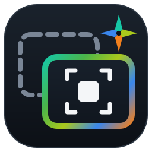</p>

Before/after change detection on the SiMa.ai Modalix MLA, through NEAT: with CYWS, trained for change detection, with DINOv2, zero-shot, or with C-3PO, trained change segmentation.

## Install

Three commands on a Modalix DevKit with the NEAT SDK and its `pyneat` environment (see [What you need](#what-you-need)), with internet access for the first install.

**01 Install.** Fetch the source into `./neat-change-studio`. The download is light, about 4 MB, with no models and none of the project page's screenshots. You download a model in step 02 or later from the web demo (Models):

```bash
cd /media/nvme && curl -fsSL https://raw.githubusercontent.com/dotimothy/neat-change-studio/main/install.sh | bash
```

`STUDIO_DIR` (or a first argument, `... | bash -s -- /path`) picks another directory, `STUDIO_BRANCH` a branch or tag, `STUDIO_REPO` another repository, and `GITHUB_TOKEN` a token for a private one. `STUDIO_ARCHIVE=/path/or/url.tar.gz` installs from an archive instead (for a board without internet), and `STUDIO_SETUP=1` runs step 02 straight away.

**02 Set up.**

```bash
cd neat-change-studio && ./setup.sh
```

It checks the `pyneat` venv (`~/pyneat`, or `PYNEAT_VENV`) and installs the Python packages it is missing (numpy, opencv-python-headless with SIFT, pillow, flask), downloads a model from Hugging Face, makes the self-signed HTTPS certificate for the web demo, and adds a `neat-change` shell alias and, when the board has a desktop, a desktop icon. In a terminal it asks about the model, the alias and the desktop icon; these variables decide without asking:

| variable | meaning |
|---|---|
| `CYWS_MODELS=bf16\|w8a16\|dinov2-448\|all\|none` | models to download (a comma-separated list works too). Default in a terminal: bf16 (asked only while the models directory has none); without a terminal: none |
| `CREATE_ALIAS=1\|0` | the `neat-change` alias in `~/.bashrc` (when there is one), the first of `~/.bash_profile`, `~/.bash_login` and `~/.profile` that exists (`~/.bash_profile` when none does), and `~/.zshrc` when your shell is zsh. Default in a terminal: yes; without a terminal: 0 |
| `CREATE_DESKTOP_ICON=1\|0` | the desktop icon and menu entry. Default without a terminal: 0 |

`./setup.sh --check-only` only checks and changes nothing. `./setup.sh --check` also loads the model on the MLA and runs one synthetic pair (it refuses while another MLA app runs). `./setup.sh --help` lists every option.

**03 Run.** Open a new shell first (or run `source ~/.bashrc`): the alias is not yet defined in the shell that ran `./setup.sh`. Without the alias, use `webapp/run.sh` in its place.

```bash
neat-change                       # the web demo at https://<board-ip>:8098 (and http://), alias for webapp/run.sh
neat-change --daemon              # the same, in the background (log: webapp/server.log)
neat-change --stop
./run.sh --mode static --before before.jpg --after after.jpg --out out/one     # the CLI, one pair
./run.sh --mode dataset --dataset-dir data/testCYWS --out out/testcyws         # a whole dataset, with metrics against the GT masks
```

Only one app may use the MLA at a time, so stop other demos first. `run.sh` activates `~/pyneat` (or `PYNEAT_VENV`) and defaults to `--model-path <models directory>/cyws_bf16_mpk.tar.gz` (or the only `cyws_*_mpk.tar.gz` there). The CLI runs CYWS only; the DINOv2 model is for the web demo.

**Update.**

```bash
neat-change update                # or: webapp/run.sh update
```

This downloads the latest `install.sh` and runs it with `STUDIO_UPDATE=1`, which fetches the latest source over the install. It keeps the models directory, `data/`, `out/`, the web demo's certificate, uploads and cache, and the other files `.gitignore` lists (`build/`, `third_party/`, virtualenvs, `*.onnx`, `.env` and so on), then runs `./setup.sh` again without prompts. With `STUDIO_ARCHIVE`, or when the download fails, it uses the install's own `install.sh`. On an install whose `webapp/run.sh` has no `update` yet, run `curl -fsSL https://raw.githubusercontent.com/dotimothy/neat-change-studio/main/install.sh | STUDIO_UPDATE=1 STUDIO_DIR=/path/to/install bash` instead. Restart a running demo afterwards (`neat-change --stop && neat-change --daemon`).

### Models

The compiled models are on Hugging Face, one repository per model family:

| model | family | repository | size | MLA time | testCYWS (Balanced preset): changes found, pixel F1, false-alarm pairs |
|---|---|---|---|---|---|
| `bf16` (the default) | CYWS, trained | [dotimothy/sima-cyws](https://huggingface.co/dotimothy/sima-cyws) | 119 MB | 35.2 ms per window pair | 33 / 47, 0.587, 2 / 15 |
| `w8a16` | CYWS, trained | [dotimothy/sima-cyws](https://huggingface.co/dotimothy/sima-cyws) | 72 MB | 27.2 ms per window pair | 31 / 47, 0.581, 3 / 15 |
| `dinov2-448` | DINOv2, zero-shot | [dotimothy/sima-dinov2](https://huggingface.co/dotimothy/sima-dinov2) | 77 MB | 24.5 ms per image | 28 / 47, 0.614, 2 / 15 |
| `c3po-pcd` | C-3PO, trained on street panoramas | not on Hugging Face: [copy or compile it](#c-3po-change-segmentation) | 166 MB | 46.7 ms per pair¹ | 28 / 47, 0.518, 2 / 15 |
| `c3po-csb` | C-3PO, trained on a simulated indoor factory | not on Hugging Face: [copy or compile it](#c-3po-change-segmentation) | 167 MB | 46.7 ms per pair¹ | 19 / 47, 0.524, 2 / 15 |

¹ `Model.benchmark`. A plain pyneat push → pull loop on the board took about 447 ms per C-3PO pair (see [C-3PO](#c-3po-change-segmentation)).

The settings of every family were tuned on the testCYWS pairs themselves, so these numbers are optimistic for new scenes (see [DINOv2, zero-shot](#dinov2-zero-shot) and [C-3PO](#c-3po-change-segmentation)).

They are kept in one **models directory**, shared by every install and left alone by updates, like Neat GenAI Studio's `/media/nvme/llima/models`. It is `/media/nvme/models/cyws` on a DevKit (`models/` in the app when there is no `/media/nvme`). `./setup.sh --models-dir DIR` moves it and remembers the choice (in `.models-dir`) for the web demo, the CLI and the alias; `CYWS_MODELS_DIR=DIR` does the same for one command; `./setup.sh --models-dir default` goes back. Setup names any models left in an app's own `models/` folder and the `mv` that brings them over. Besides `./setup.sh`, these download into it:

```bash
webapp/run.sh --fetch bf16        # or w8a16, dinov2-448, or all
webapp/run.sh --list-hub          # what Hugging Face has, what is here, and the space used
webapp/run.sh --verify all        # check the models here against their published SHA-256
webapp/run.sh --delete w8a16      # delete a model (not the one the running demo has loaded)
```

The web demo manages them too, in the **Models** window (the chip button in the header, the status pill, or ☰ → Models on a phone), like the model managers of Neat Decision Studio and Neat GenAI Studio. It has three tabs: **Models** (what is on the board), **Add Model** (what Hugging Face has that the board doesn't) and **About**. Each model has a card with its state and these actions:
- **Load:** puts the model on the MLA. One model is on the MLA at a time, so Load switches to it.
- **Unload:** frees the MLA for other apps. Detection is off until a model is loaded again.
- **Download:** fetches a model, with progress, cancel and resume. Every download is checked against its SHA-256.
- **Verify:** checks a model against its published SHA-256 (about a second on the board).
- **Re-download:** fetches a fresh copy. The old file stays in use until the new one has arrived and passed its check, so a failed re-download loses nothing.
- **Delete:** removes the model after asking. The loaded model can't be deleted; unload it first.
- **Model Card:** the model's facts: family and architecture, input, precision, latency, accuracy on testCYWS, size, source and license.

The window also shows the storage: how many models are on the board, the space they use, the free space, and which folder they are in.

To compile the model yourself instead, see [Compile the model](#compile-the-model).

### From a host instead: deploy.sh

`deploy.sh` copies the app, the web demo and the scripts from a clone on the host to the board over ssh and rsync, then runs `setup.sh` there (without prompts, so it downloads no model unless you deployed one). `BOARD` is required; `REMOTE` defaults to `/media/nvme/cyws`, and a deployed MPK goes to the board's models directory, `/media/nvme/models/cyws` (or `CYWS_MODELS_DIR`). It refuses while another MLA app runs on the board, unless `FORCE=1`.

```bash
BOARD=sima@<devkit-ip> ./deploy.sh
# or also copy a model you compiled yourself:
BOARD=sima@<devkit-ip> ./deploy.sh build/bf16/cyws_bf16_mpk.tar.gz
```

Then, on the board, `cd /media/nvme/cyws`, `webapp/run.sh --fetch bf16` (unless you deployed an MPK) and the commands of step 03, with `webapp/run.sh` in place of `neat-change`.

## About

Give it a **before** photo and an **after** photo of the same scene. It returns boxes around what changed (labelled *appeared*, *disappeared* or *changed*), a change mask and an overlay. The model is the original **"The Change You Want to See"** (Sachdeva & Zisserman, WACV 2023; [paper code](https://github.com/ragavsachdeva/The-Change-You-Want-to-See)): a Siamese ResNet-50 U-Net with co-attention and a CenterNet head. It runs on the Modalix MLA through NEAT (`pyneat`) as **one MLA ELF with no A65 stages**, at about 35 ms per 256×256 pair in bf16.

High-resolution photos are tiled. One global window runs first, then 256-input tiles are run only where the global view saw some change. This lets small objects be found at the scale the model was trained on.

### DINOv2, zero-shot

The second model family needs no change-detection training at all. [DINOv2](https://github.com/facebookresearch/dinov2) (Meta) ViT-S/14 with 4 registers is a general image feature extractor, compiled to **one MLA ELF with no A65 stage** (4 EV74 plugins). It takes one 448×448 image and returns a feature for each of its 32×32 patches, in 24.5 ms on the MLA (50 images/s, 14.0 W); its features match PyTorch FP32 to a patch cosine of 0.994 (0.997 centred). Both photos go through it, and so do overlapping tiles of them, which show small objects larger. A patch of the after photo with no similar patch nearby in the before photo is new; a patch of the before photo with no similar patch nearby in the after photo is gone. The score map becomes a mask and boxes, labelled like CYWS's.

| on testCYWS (28 pairs, 47 changes, 15 no-change pairs) | changes found | pixel F1 | false-alarm pairs |
|---|---|---|---|
| DINOv2, whole photo only (board bf16) | 27 / 47 | 0.566 | 1 / 15 |
| DINOv2, whole photo + 0.6 tiles (Balanced) | 28 / 47 | 0.614 | 2 / 15 |
| DINOv2, + tiles, recall-leaning (threshold 0.35) | 30 / 47 | 0.603 | 3 / 15 |
| CYWS bf16, Balanced | 33 / 47 | 0.587 | 2 / 15 |

These settings were tuned on the same pairs, for both models, so the numbers are optimistic for new scenes. In the web demo DINOv2 shares the controls: the presets (Fast: the whole photo; Balanced: plus tiles where the whole photo saw a change; Accurate: tiles everywhere, threshold 0.35), the threshold, the windows and photo alignment. Its MLA time is per image, so a pair is two images per window. The DINOv2 port, its compile and its evaluation are in a sibling project; the model card on [dotimothy/sima-dinov2](https://huggingface.co/dotimothy/sima-dinov2) has the input and output contract.

### C-3PO, change segmentation

The third family is [C-3PO](https://github.com/DoctorKey/C-3PO) ("How to Reduce Change Detection to Semantic Segmentation", Wang et al., Pattern Recognition 2023; MIT). It takes a before and an after image, 256×256 each, and segments what changed: a ResNet-18 shared by both photos, an MTF module that merges their features as appeared, disappeared and exchanged, MSF over four scales and a DeepLabV3 head (44.7 M parameters). It compiles to **one MLA ELF with no A65 stage** and runs in 46.7 ms per pair (`Model.benchmark`, 24.5 pairs/s, 12.8 W); bf16 agrees with FP32 on 99.98% of mask pixels. Two released checkpoints are compiled, with the same graph: **PCD** (street panoramas, `c3po-pcd`) and **ChangeSim binary** (a simulated indoor factory, `c3po-csb`). The studio runs the whole photo (and, like DINOv2, overlapping 0.6 tiles), takes the change probability 1 − P(no change) of each window, combines them by a per-pixel max and thresholds it into a mask and boxes. The checkpoints are binary, so every box is labelled *changed*: C-3PO cannot tell appeared from disappeared, and the page shows only the Changed count for it.

| on testCYWS (FP32 ONNX, threshold 0.20) | changes found | pixel F1 | false-alarm pairs |
|---|---|---|---|
| C-3PO PCD, whole photo (Fast) | 26 / 47 | 0.499 | 1 / 15 |
| C-3PO PCD, + gated 0.6 tiles (Balanced) | 28 / 47 | 0.518 | 2 / 15 |
| C-3PO PCD, + all 0.6 tiles (Accurate) | 30 / 47 | 0.554 | 2 / 15 |
| C-3PO ChangeSim, whole photo (Fast) | 19 / 47 | 0.524 | 2 / 15 |
| C-3PO ChangeSim, + gated 0.6 tiles (Balanced) | 19 / 47 | 0.524 | 2 / 15 |
| C-3PO ChangeSim, + all 0.6 tiles (Accurate) | 22 / 47 | 0.536 | 2 / 15 |

Neither checkpoint was trained on photos like these, and it shows: C-3PO is behind CYWS and DINOv2 here. The threshold was tuned on the same pairs (0.10 to 0.50, the best pixel F1 with at most 2 false-alarm pairs), and 0.20 suits both checkpoints. The numbers are from ONNX Runtime FP32 on a PC. The 46.7 ms MLA time is `Model.benchmark`'s. A standalone pyneat loop on the board that pushes one pair and pulls its result before the next (the C-3PO port's `eval/board_run.py`) measured about 447 ms per pair (p50 447 ms, 28 pairs), about ten times that; the gap is outside the MLA, in the tensor path through pyneat. The studio keeps two pairs in flight to hide some of it, but its own per-pair time on the board is still to be measured, so expect up to about 0.45 s per pair: Fast runs one pair, Accurate 7 on a 4:3 photo.

The C-3PO models are not on Hugging Face. To use one, copy its MPK into the models directory (`/media/nvme/models/cyws` on a DevKit) and it appears in the Models window:

```bash
scp c3po_pcd_256_bf16_mpk.tar.gz c3po_csb_256_bf16_mpk.tar.gz sima@<board>:/media/nvme/models/cyws/
```

To build them, use the C-3PO port, a sibling project (`MLSandbox/C3PO`): `model/export_onnx.py --ckpt pcd` (or `csb`) exports the ONNX, and `compile/compile.sh --precision bf16` compiles `build/bf16_pcd_256/c3po_pcd_256_bf16_mpk.tar.gz`. With `--backend onnx` the studio runs C-3PO on a PC from `C3PO_ONNX`, else `build/onnx/c3po_<ckpt>_256.onnx` here, else the sibling project's `build/onnx` (`C3PO_DIR`, default `../C3PO`).

It is a sibling of [Neat Decision Studio](https://github.com/dotimothy/neat-decision-studio). The compiled models are on Hugging Face in the collection [SiMa.ai Change Detection Models](https://huggingface.co/collections/dotimothy/simaai-change-detection-models-6ada4e701e447e9db528596b). Results and measurements are in [report.md](report.md). The project page is at **[timothydo.me/neat-change-studio](https://timothydo.me/neat-change-studio/)**.

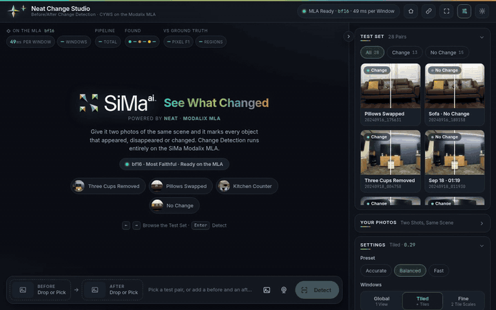

## What you need

**To run it:**
- A Modalix DevKit with the NEAT SDK 0.5.0 (platform 2.1.3) and its `pyneat` venv. The scripts look for it in `~/pyneat`; set `PYNEAT_VENV` if it is elsewhere.
- ssh from the host to the board (passwordless is easiest; `deploy.sh` and `run_all.sh` use ssh and rsync).
- On the board, numpy, OpenCV (4.4 or later, for SIFT) and Pillow in the pyneat venv, and Flask for the web demo. `./setup.sh` checks them and installs what is missing ([requirements.txt](requirements.txt)).

**To compile the model** (not needed if you download it; see [Compile the model](#compile-the-model)):
- [uv](https://docs.astral.sh/uv/) and Python 3 on the host, with PyTorch installed. `run_all.sh` makes `.venv` with `--system-site-packages`, so it reuses that PyTorch; the other host packages are in [requirements-dev.txt](requirements-dev.txt).
- The SiMa NEAT SDK container with the Model Compiler. `compile/compile.sh` runs the compiler with `docker exec` in the container named by `CONTAINER` (default `ghcr.io-sima-neat-sdk-latest`). The repo must be under the host folder mounted as the container's `/workspace`, given by `WS_HOST` (default `~/SDK/NEAT/workspace`).
- `pyneat` comes from the NEAT SDK, and `afe` / `sima_utils` from the Model Compiler container. Neither is on PyPI.

## The CLI

`./run.sh` runs one pair (`--mode static --before … --after …`) or a whole dataset (`--mode dataset --dataset-dir …`) on the MLA and writes the results to `--out`.

### Presets

| preset | what it runs | testCYWS (bf16 on the board) |
|---|---|---|
| `fast` | the global window only | 29 of 47 changes found, ~0.35 s per 12 MP pair (dataset mode) |
| `balanced` (default) | global window, then tiles of 0.45 × the short side where the global heat is ≥ 0.25 | 33 of 47, ~0.41 s per pair, 3.4 windows on average |
| `accurate` | global window plus every tile | finds what balanced finds, at ~4× the MLA time |

Any flag given explicitly overrides the preset. The ones you are most likely to want:

| flag | meaning |
|---|---|
| `--thr 0.29` | detection threshold on the heatmap |
| `--levels 0,1` / `--tiles gated\|full` / `--tile 0.45` | tiling levels, gating, tile side (pixels, or a fraction of the short side) |
| `--register` | align before to after on the CPU first (SIFT + MAGSAC homography); use for handheld captures. Turns on `--verify-change`, which drops boxes whose patches still match after the warp. Costs ~0.6–0.8 s of A65 time per pair. |
| `--mask-mode box\|diff` | filled boxes, or a pixel-difference mask inside each box (needs `--register`) |
| `--work-long 1920` | decode JPEGs at reduced resolution (long side ≥ 1920); `0` = native |
| `--backend neat\|onnx\|afe\|fake` | board MLA, host ONNX FP32, host compiler simulator, or a synthetic stand-in |
| `--bench` | per-stage timing table |

### Outputs

For every pair: `<id>_overlay.jpg`, `<id>_mask.png` and `<id>.json`. The JSON holds boxes in the working frame (`box`) and in original pixels (`box_orig`), labels, scores, windows and timings. Dataset mode adds `summary.csv` (one row per pair) and `metrics.json` (means plus pooled pixel IoU/F1).

## Dataset

The numbers in [report.md](report.md) come from testCYWS, the author's private set of 28 before/after phone-photo pairs. It is not published, so bring your own pairs in this layout:

```
data/testCYWS/
  images/<id>_ref.jpg    before
  images/<id>_cap.jpg    after
  masks/<id>.jpg         change mask (optional; needed for metrics)
```

The default location is `data/testCYWS` in the repo; set `CYWS_DATA` to use another folder (the scripts' `--dataset-dir` / `--data` flags also take a path). `deploy.sh --with-data` copies it to the board. If your pairs are on Google Drive, `data/download_testcyws.sh MANIFEST` fetches them file by file from a manifest you provide (see [data/testcyws_manifest.example.tsv](data/testcyws_manifest.example.tsv)).

## Web demo

```bash
# on the board (stop other MLA apps first)
neat-change --daemon      # or webapp/run.sh --daemon: http://<board-ip>:8098/  (https:// on the same port for the webcam)
neat-change --stop
```

Pick a test pair or upload two photos (on a phone you can take them with the camera). Choose a preset or adjust settings, and see the boxes, heatmap, tiles and timing. It also works on phones. Every screenshot here was taken on a Modalix DevKit, so the timings are the board's own.

**The start screen and a result.** A result shows the boxes, labelled *appeared*, *disappeared* or *changed*, over the after photo with the heat map. Next to it are the MLA time per window, the whole pipeline's time and, for test pairs, the score against the annotated mask.

<table>
<tr>
<td width="50%">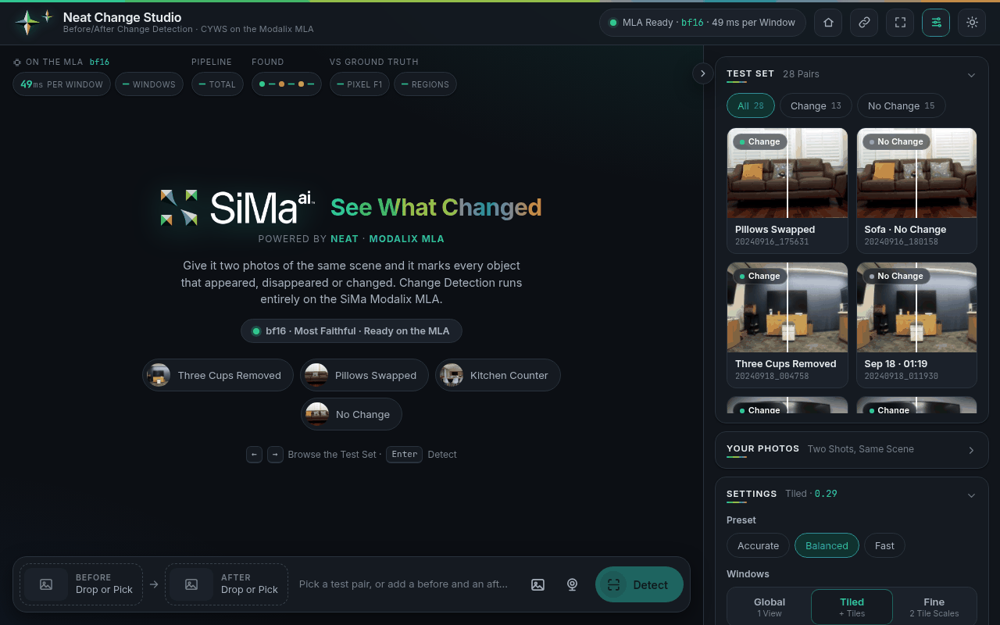</td>
<td width="50%">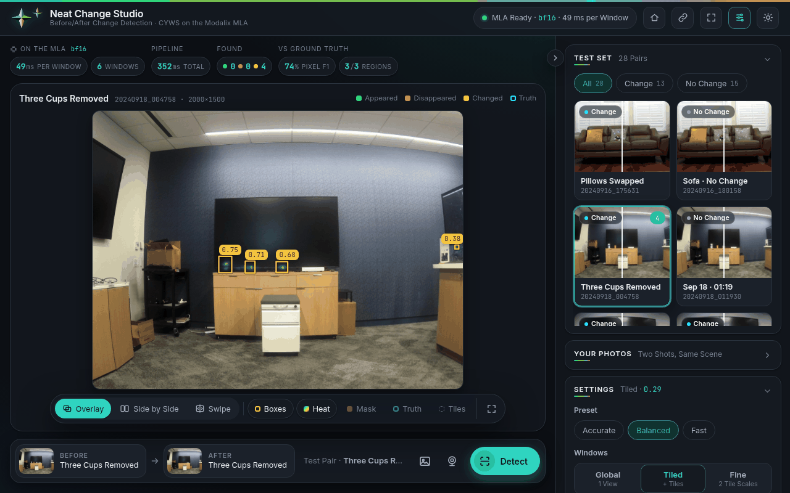</td>
</tr>
</table>

**Comparing.** Overlay, side by side, or a swipe slider between before and after. Layers for the heat map, the change mask, the ground truth and the tiles the MLA ran.

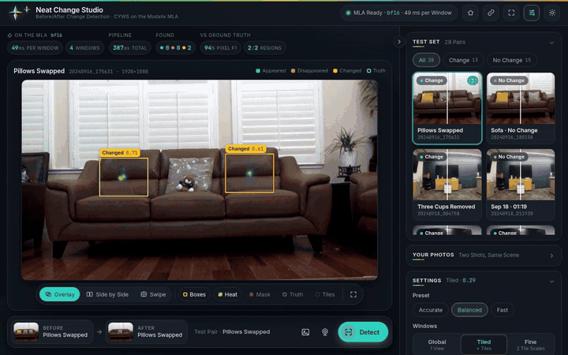

**Tuning.** Presets (Fast, Balanced, Accurate), the windows, the threshold and photo alignment. Each change re-runs straight away. The decoded photos are cached, so a re-run takes about half a second on the board.

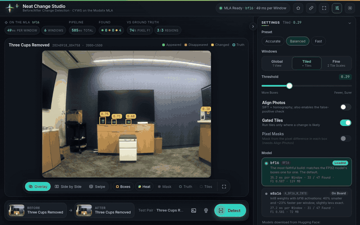

**The whole test set.** Run every test pair with the current settings, scored against the annotated masks: changes found, false alarms, time per pair and F1, pair by pair.

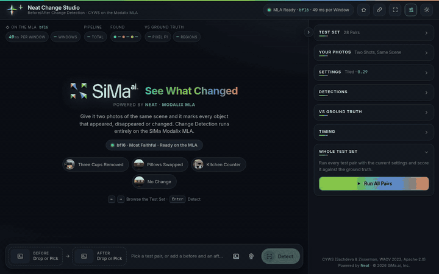

**Webcam.** Capture **Before**, change something, then capture **After**. A self-timer (3, 5 or 10 s) counts down before each shot, and a faint ghost of Before helps line up After. While you line up After, an **alignment check** compares the camera with Before in the browser (OpenCV.js in a Web Worker: ORB matches and a RANSAC fit): it shows a score (Aligned, Almost, Not Aligned), the Before frame's outline on the live view, an arrow to move the camera by, and hints such as Step Back or Level the Camera. The **Align** button turns it on and off, and the choice is remembered. If After is taken while it is not aligned, the demo suggests turning on Align Photos. **Watch Live** then compares every new frame with Before and keeps the result up to date. Here the camera is fed one of the test pairs.

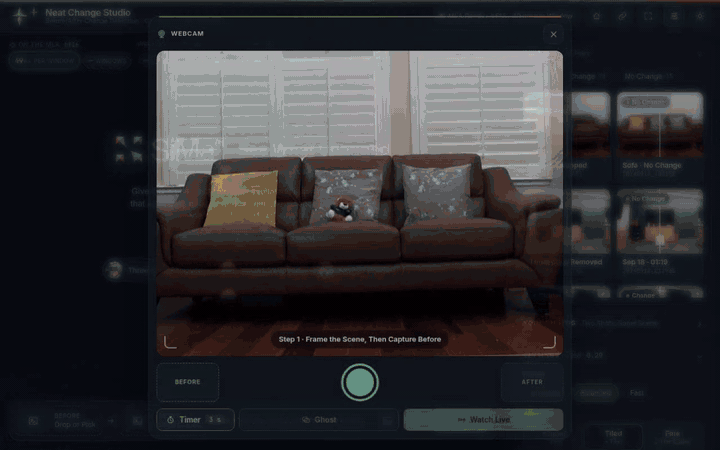

**Models.** The Models window lists the models on the board and, under Add Model, the ones on Hugging Face (CYWS and DINOv2). A model that isn't on the board downloads with progress and a checksum check, and Load switches the MLA over to it; Unload frees the MLA. Each card has a Model Card with the model's facts. (The recording below is of the earlier model list in Settings.)

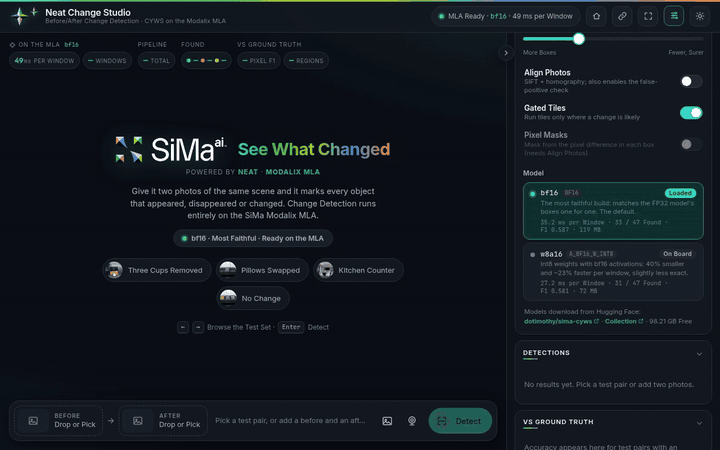

**On a phone.** The same page, with a tab bar. The header has buttons for full screen and for dark or light mode, and the ☰ menu has both too. Where the browser has no full-screen support (iPhone Safari), full screen hides the header and the metric chips instead; adding the page to the home screen opens it full screen (the demo has a web app manifest).

<table>
<tr>
<td width="32%">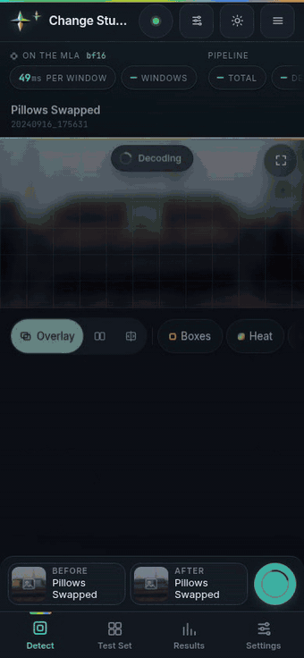</td>
<td width="68%">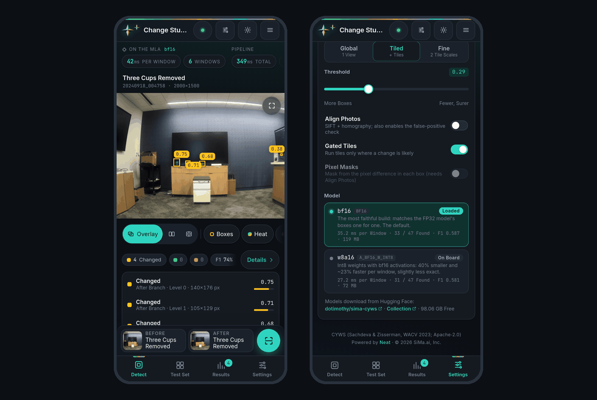</td>
</tr>
</table>

On the host it can run without a board:

```bash
.venv/bin/python webapp/server.py --backend onnx --data data/testCYWS
.venv/bin/python webapp/server.py --backend fake --data data/testCYWS     # no model needed
```

The `onnx` backend uses `build/onnx/cyws_fused.onnx`, which `model/fetch_upstream.sh` and `model/export_onnx.py` make (or run `./run_all.sh` up to its `export` step).

**Server flags** (`webapp/server.py`; `webapp/run.sh` passes them on):

| flag | meaning |
|---|---|
| `--port 8098` | port for both HTTP and HTTPS |
| `--model bf16\|w8a16\|dinov2-448\|c3po-pcd\|c3po-csb` | model to load at start (when its file is missing, the demo starts with no model loaded) |
| `--models DIR` | where the MPKs are (default `models/`) |
| `--data DIR` | test pairs to offer (default `data/testCYWS`) |
| `--backend neat\|onnx\|fake` | board MLA, host ONNX FP32, or a synthetic stand-in |
| `--hub-repo REPO,…` | Hugging Face repositories to list models from, comma-separated (default `dotimothy/sima-cyws,dotimothy/sima-dinov2`; `''` turns the catalog off) |
| `--fetch NAME…` | download these models into `--models` and exit (`all` for every one) |
| `--list-hub` | list the models on Hugging Face, and which are here, and exit |
| `--verify NAME…` | check these models against their published SHA-256 and exit (`all` for every one here) |
| `--delete NAME…` | delete these models from `--models` and exit (refused for the model the running demo has loaded) |
| `--no-https` | plain HTTP only |

**Models from Hugging Face:**
- The **Models** window's Add Model tab lists the models on [dotimothy/sima-cyws](https://huggingface.co/dotimothy/sima-cyws) and [dotimothy/sima-dinov2](https://huggingface.co/dotimothy/sima-dinov2), as Neat GenAI Studio and Decision Studio do. A model that isn't on the board shows a **Download** button.
- A download fetches the model into the models directory, with progress, cancel and resume, and checks its SHA-256 before the model can be loaded.
- A model on the board has **Load** (or **Unload** when it is on the MLA), **Verify**, **Re-download** and **Delete** buttons, and a storage bar shows the space the models use.
- On a fresh board, the first model downloaded loads by itself. `POST /api/models/unload` and `POST /api/models/load {name}` do the same as the buttons.

The right-hand panel collapses with the round button on its edge, and the header's Settings button opens it at Settings.

**Webcam:** the webcam button captures Before, then After, from the browser's camera and detects. **Watch Live** compares every new frame with Before and updates the view (about 2 frames/s on the board with a 1080p webcam, most of it capture and upload). Browsers only allow the camera on HTTPS pages, so port 8098 speaks both HTTP and HTTPS (the server checks whether each connection starts with a TLS handshake). `./setup.sh` (or `webapp/run.sh` on first start) makes a self-signed certificate in `webapp/certs/` with `openssl` (`webapp/make_cert.sh`), so the browser warns about it once. `server.py` run directly uses `--cert` / `--key` (default `webapp/certs/cert.pem` and `key.pem`) if they exist, and serves HTTP only otherwise. The plain-HTTP page links to the HTTPS one when you open the webcam. `--no-https` turns HTTPS off.

## Compile the model

You don't need to: the compiled models are on Hugging Face (see [Models](#models)). Compile it yourself to check the build, or to change the model.

This runs on an x86 host, not the board. You need:
- PyTorch;
- [uv](https://docs.astral.sh/uv/);
- the SiMa NEAT SDK container with the Model Compiler, running and named `ghcr.io-sima-neat-sdk-latest` (or set `CONTAINER`);
- this repo inside the folder the container mounts at `/workspace`, which is `~/SDK/NEAT/workspace` by default (or set `WS_HOST`).

See [What you need](#what-you-need) for details.

### bf16 (the shipped model, no photos needed)

bf16 has no scales to fit, so it needs no calibration photos. Four commands, from the repo:

```bash
STEPS=setup ./run_all.sh                         # 1. host venv (.venv) with onnx, onnxsim, onnxruntime, ...
model/fetch_upstream.sh                          # 2. upstream CYWS code and the pretrained checkpoint (checksum-checked)
.venv/bin/python model/export_onnx.py            # 3. MLA-friendly rewrite -> build/onnx/cyws_fused.onnx
compile/compile.sh --precision bf16 --out build/bf16    # 4. compile in the SDK container (about 10 minutes)
```

- **Step 2** puts the code in `third_party/` and the checkpoint in `build/ckpt/`. Both are gitignored.
- **Step 3** loads the checkpoint strictly, rewrites the network for the MLA and exports ONNX (opset 17, simplified). It checks ONNX Runtime against PyTorch, and refuses any op outside the list the MLA compiles.
- **Step 4** writes `build/bf16/cyws_bf16_mpk.tar.gz`, with `compile.log` and `compile_summary.json` next to it. It fails unless the MPK has exactly one MLA ELF and no A65 stage.

Optionally, check the result:

```bash
.venv/bin/python model/verify_reference.py                    # the rewrite matches upstream CYWS
.venv/bin/python compile/mpk_io.py build/bf16/cyws_bf16_mpk.tar.gz   # input order: in0_before, then in1_after
```

Then put it on the board. Either `BOARD=sima@<devkit-ip> ./deploy.sh build/bf16/cyws_bf16_mpk.tar.gz`, or copy it into the board's models directory (`/media/nvme/models/cyws`) yourself. It replaces the downloaded bf16 there.

### w8a16 (needs your photos)

int8 weights need **paired** calibration samples. Put your before/after pairs in `data/testCYWS` (or point `CYWS_DATA` at them), in the layout described in [Dataset](#dataset). Then:

```bash
.venv/bin/python model/export_onnx.py --outputs split         # separate heat/wh/offset outputs, so each gets its own scale
.venv/bin/python data/make_calib.py                           # paired crops through the app's own preprocessing
compile/compile.sh --model build/onnx/cyws_split.onnx --precision w8a16 \
    --calib build/calib/calib_pairs.npz --calib-method min_max --out build/w8a16_minmax
```

### Everything, as in the report

`./run_all.sh` runs every step in order:
1. venv, dataset, upstream code and checkpoint;
2. reference check, ONNX export, probe compiles;
3. calibration, the bf16 and w8a16 compiles;
4. the FP32 reference and the board evaluation.

`SKIP_BOARD=1` skips the board steps. `STEPS="export compile"` runs only the steps you name. The board steps need `BOARD=sima@<devkit-ip>` and passwordless ssh.

**Compilation notes:**
- **bf16 setting:** bf16 needs `XLA_FLAGS=--xla_backend_extra_options=-vectorize-loops=false,-vectorize-slp=false`; `compile/compile.sh` sets it.
- **Single-ELF check:** `compile/cyws_compile.py` exits with an error unless the MPK has exactly one MLA ELF and no A65 stage.
- **Rewrite for the MLA:** the rewrite folds BatchNorm and writes co-attention as Einsum/Softmax with Split/Concat flattening. It expands the scSE spatial gate with a 1→C ones-conv, because two broadcast multiplies fail to compile. It splits the 6144→256 decoder conv into three input-channel chunks, because the single conv fails after "large tensor support". Each compiler failure and its fix is recorded in [report.md](report.md).
- **Calibration:** uses real **paired** before/after crops from the app's own preprocessing (`data/make_calib.py`).
- **Input order:** the MPK's input order is checked by `compile/mpk_io.py`: `in0_before`, then `in1_after`.
- **int8:** full int8 fails quantization (see the report). w8a16 compiles, but bf16 is more accurate on the board, so bf16 is the default.

**Tests:** `.venv/bin/python -m pytest tests -q` (host only; the web demo tests are skipped without Flask).

## Model input contract

There are two inputs, always pushed together and in this order:
- `in0_before` and `in1_after`, each float32 256×256×3 HWC, RGB, pixel / 255, with no mean/std normalisation.

There is one fused output, `(10, 256, 256)` float32, with channels `heat_b, heat_a, wh_b(w,h), wh_a(w,h), off_b(x,y), off_a(x,y)`. The heat channels are already passed through a sigmoid.

**DINOv2** (`dinov2-448`) has one input, a float32 448×448×3 HWC image, RGB, pixel / 255 (the ImageNet mean/std is inside the model), and one output, `(1, 384, 1, 1029)` float32: the class token, 4 registers and 32×32 patch tokens, row by row.

**C-3PO** (`c3po-pcd`, `c3po-csb`) has two inputs, `in0_before` and `in1_after`, pushed in that order, each a float32 256×256×3 HWC image, RGB, pixel / 255 (the ImageNet mean/std is inside the model), and one output, logits `(1, 2, 64, 64)` float32 (pyneat may hand them back channels last). Class 0 is no change; the change probability is 1 − softmax(logits)[0], upsampled bilinearly to the photo.

## Layout

| path | what |
|---|---|
| `app/` | The application: deployed to the board as `/media/nvme/cyws/app`. `run_cyws_neat.py` is the CLI; [app/API.md](app/API.md) documents the modules. |
| `webapp/` | Browser demo (Flask), served from the board on port 8098. |
| `model/` | Upstream fetch, the MLA-friendly rewrite (`cyws_mla.py`), the reference check and the ONNX export. |
| `compile/` | Model Compiler driver (bf16 / w8a16 / int8), probes, MPK input-order check. |
| `data/` | Dataset download from a manifest, dataset inspection, calibration tensors. |
| `eval/` | Raw-output comparison against FP32, GPU backend, inference cache, parameter sweep. |
| `bench/` | `bench_on_board.py`: streamed throughput and `Model.benchmark` on the DevKit. |
| `tools/` | `publish_hub.py`, for maintainers: uploads the MPKs to Hugging Face and regenerates `models.json` (the list the app reads) and the model card, per family (`--family cyws\|dinov2\|c3po`; C-3PO is not published, so only use `--dry-run` for it for now). Needs `huggingface_hub` and write access to the repository; `--dry-run DIR` writes the two files locally instead. |
| `results/` | Small result files behind the numbers in the report: the parameter sweep (`sweep_RESULTS.md`) and the board-vs-FP32 comparisons (`eval/`). |
| `tests/` | pytest suite (host, no board needed). |
| `install.sh`, `setup.sh`, `run.sh`, `deploy.sh`, `run_all.sh` | install or update on the board, board setup (packages, model, certificate, alias, desktop icon), CLI runner, deploy from a host, full reproduction. |

Not in the repository (made by the scripts): `build/`, `third_party/`, `.venv/`, `models/`, `out/` and `data/testCYWS/`.

## License

Apache License 2.0 ([LICENSE](LICENSE), [NOTICE](NOTICE)).

CYWS is by Ragav Sachdeva and Andrew Zisserman (The Change You Want to See, WACV 2023, https://github.com/ragavsachdeva/The-Change-You-Want-to-See). The authors have confirmed to the maintainer (2026) that CYWS, its code and pretrained weights, is released under the Apache License 2.0. This supersedes the CC BY-NC default mentioned in upstream issue #11 (2024). The upstream repository does not include a LICENSE file yet.

- **Derived files:** the checkpoint, the ONNX files and the compiled MPKs are derived from the authors' pretrained weights and are also Apache-2.0. None of them is in this repository; the MPKs are on [Hugging Face](https://huggingface.co/dotimothy/sima-cyws).
- **DINOv2:** its code and pretrained weights are by Meta Platforms, Inc. (https://github.com/facebookresearch/dinov2), under the Apache License 2.0. The compiled `dinov2-448` model is derived from those weights and is Apache-2.0 too; it is on [Hugging Face](https://huggingface.co/dotimothy/sima-dinov2).
- **C-3PO:** its code and pretrained weights are by Guo-Hua Wang et al. (https://github.com/DoctorKey/C-3PO), under the MIT License. The compiled `c3po-pcd` and `c3po-csb` models are derived from those weights and are MIT too; they are not in this repository or on Hugging Face.
- **This repository's code** is Apache-2.0.
- **Fonts:** Inter and JetBrains Mono, in the web demo, are under the SIL Open Font License 1.1.
- **Trademarks:** SiMa.ai, Modalix, Neat and the logos in `webapp/web/assets` are trademarks of SiMa.ai and are not covered by the Apache License.

## Citation

```bibtex
@inproceedings{sachdeva2023change,
  title={The Change You Want to See},
  author={Sachdeva, Ragav and Zisserman, Andrew},
  booktitle={Winter Conference on Applications of Computer Vision (WACV)},
  year={2023}
}
```

For the DINOv2 model:

```bibtex
@article{oquab2023dinov2,
  title={DINOv2: Learning Robust Visual Features without Supervision},
  author={Oquab, Maxime and Darcet, Timoth{\'e}e and Moutakanni, Th{\'e}o and others},
  journal={Transactions on Machine Learning Research},
  year={2024}
}
```

For the C-3PO model:

```bibtex
@article{wang2023c3po,
  title={How to Reduce Change Detection to Semantic Segmentation},
  author={Wang, Guo-Hua and Gao, Bin-Bin and Wang, Chengjie},
  journal={Pattern Recognition},
  year={2023}
}
```
